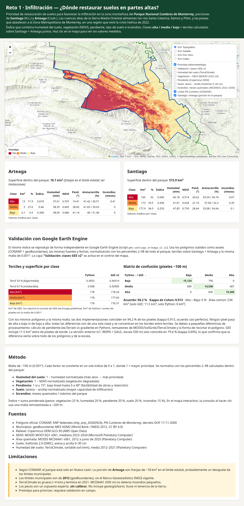

# Reto 1 · Infiltración — ¿Dónde restaurar suelos en las partes altas?
### Prioridad de restauración en el Parque Nacional Cumbres de Monterrey: Santiago y Arteaga

**Equipo: ____**



## 1. Problema
La Zona Metropolitana de Monterrey (ZMM) depende de las presas La Boca, Cerro Prieto y El Cuchillo, y de los acuíferos que se recargan en la Sierra Madre Oriental. La sequía de 2022 (declaratoria de emergencia en Nuevo León) mostró lo frágil que es el abasto. Restaurar suelos en las partes altas (cubierta vegetal, obras de retención, control de erosión) aumenta la infiltración y la recarga. Los recursos son limitados, así que hay que decidir **dónde** intervenir primero.

## 2. Solución
Un **índice de prioridad de restauración** reproducible, a ~100 m, que combina cinco factores medidos con datos abiertos y clasifica el territorio en prioridad **alta / media / baja**. Se entrega como:
- **Página web interactiva** (`resultados/pagina_santiago_arteaga.html`): mapa con clases y factores que se pueden activar, consulta de valores al hacer clic, fichas por municipio y validación con GEE.
- **Ficha PDF** de una página (`resultados/ficha_santiago_arteaga.pdf`).
- **GeoTIFFs** del índice y de las clases, listos para SIG.
- **Script de Google Earth Engine** que replica el método (validado con 94.2 % de acuerdo).

## 3. Enfoque: Santiago y Arteaga dentro del PN Cumbres
El análisis se recorta al **polígono oficial CONANP** del PN Cumbres de Monterrey (decreto DOF 17-11-2000, 177,395.95 ha) y se concentra en la zona montañosa de **Santiago** (515.9 km² dentro del parque) y **Arteaga** (18.1 km²). Los terciles se calculan sobre estas dos porciones juntas (534 km²).

## 4. Método y pesos
Cada factor se convierte en un sub-índice de 0 a 1 (1 = mayor prioridad), normalizado con los percentiles 2–98 **de todo el parque**:

| Factor | Fuente | Sub-índice | Peso |
|---|---|---|---|
| Vegetación | NDVI MODIS MOD13Q1 v061 (mediana 2023–2024) | 1 − NDVI norm. (vegetación degradada) | 25 % |
| Humedad del suelo | TerraClimate `soil` (mm, media 2012–2021) | 1 − humedad norm. (déficit) | 20 % |
| Pendiente | Copernicus DEM GLO-30 | 1 si ≤ 15°, baja lineal hasta 0 a 40° | 20 % |
| Suelo | SoilGrids 2.0, arena − arcilla 0–30 cm | norm. (más capacidad de infiltración) | 20 % |
| Incendios | MODIS MCD64A1 v061 (2012 a junio de 2025) | meses quemados / máximo del parque | 15 % |

Índice = suma ponderada. Clases = terciles del índice en Santiago + Arteaga (umbrales 0.3653 y 0.5080). Los pesos se editan en `codigo/config.json`.

## 5. Resultados (valores medios por clase)
**Santiago (515.9 km²)**

| Clase | km² (%) | Índice | Humedad (mm) | NDVI | Pendiente (°) | Arena / arcilla (%) | Incendios (meses) |
|---|---|---|---|---|---|---|---|
| Alta | 165.0 (32.0) | 0.606 | 40.2 | 0.514 | 20.6 | 39.3 / 30.7 | 0.67 |
| Media | 173.0 (33.5) | 0.436 | 41.8 | 0.634 | 27.2 | 37.1 / 32.2 | 0.35 |
| Baja | 177.9 (34.5) | 0.253 | 47.9 | 0.759 | 28.6 | 33.1 / 34.6 | 0.10 |

**Arteaga (18.1 km²: franjas en el límite estatal, ver limitaciones)**

| Clase | km² (%) | Índice | Humedad (mm) | NDVI | Pendiente (°) | Arena / arcilla (%) | Incendios (meses) |
|---|---|---|---|---|---|---|---|
| Alta | 13.0 (71.9) | 0.618 | 37.6 | 0.537 | 19.4 | 41.4 / 30.5 | 0.41 |
| Media | 5.0 (27.6) | 0.460 | 38.4 | 0.665 | 28.8 | 41.7 / 30.6 | 0.00 |
| Baja | 0.1 (0.5) | 0.348 | 38.1 | 0.686 | 41.1 | 40.0 / 31.5 | 0.00 |

Las zonas de prioridad alta son más secas, con menos vegetación, pendientes más suaves, suelos más arenosos y más incendios. Se concentran en las partes altas del poniente de Santiago (hacia Potrero Redondo y Laguna de Sánchez, 2,000–2,650 m).

## 6. Validación con Google Earth Engine
El método se reimplementó de forma independiente en GEE (`gee/gee_santiago_arteaga_v2.js`) con los mismos polígonos (assets) y la misma malla de 0.001°:

| | Python | GEE v2 |
|---|---|---|
| Tercil 33 % / 67 % | 0.3653 / 0.5080 | 0.36519 / 0.50585 |
| km² alta / media / baja | 178.0 / 178.0 / 178.0 | 178.24 / 177.65 / 176.31 |

**Acuerdo: 94.2 % · Kappa de Cohen: 0.913**. No hay ninguna confusión alta↔baja; las diferencias son de una sola clase, en los bordes entre terciles (detalle en `resultados/comparacion_gee_v2.*`).

## 7. Cómo reproducir
### Python
```bash
cd codigo
python3 -m venv .venv && . .venv/bin/activate
pip install -r requirements.txt
python indice_parque.py      # descarga capas (sin credenciales) a codigo/data/ y escribe codigo/out/parque/
python ficha.py              # ficha PDF/PNG
python comparar_gee.py ../resultados/clases_gee_v2.tif out/parque/comparacion_gee_v2 "GEE v2"
python pagina.py             # página HTML (requiere el paso anterior)
```
Ejecuta todo **desde `codigo/`** (las rutas son relativas a esa carpeta). Las capas vienen de AWS Open Data, Microsoft Planetary Computer e ISRIC, sin cuentas. El polígono del parque se lee de `datos/pn_cumbres.geojson`; los municipios se descargan de geoBoundaries.
`indice_infiltracion.py` contiene las funciones de descarga y la configuración que usan los demás scripts.

### Google Earth Engine
1. En code.earthengine.google.com > **Assets > NEW > Shape files**, sube cada zip de `gee/assets/` (o sus 4 archivos `.shp/.shx/.dbf/.prj`) con los Asset IDs `pn_cumbres_conanp`, `aoi_santiago_arteaga` y `municipios_parque`.
2. Ajusta la variable `PROY` del script a la ruta de tu proyecto (por defecto `projects/hackaton-2026-mty/assets/`).
3. Pega `gee/gee_santiago_arteaga_v2.js`, pulsa **Run** y ejecuta la exportación `clases_gee_v2` en **Tasks**.

## 8. Fuentes y licencias
| Dato | Fuente | Licencia |
|---|---|---|
| Polígono ANP | CONANP, shp_anp_20260924 (sig.conanp.gob.mx/Shape) | Datos abiertos Gob. MX |
| Municipios | geoBoundaries MEX ADM2 (World Bank / INEGI 2012) | CC BY 4.0 |
| Relieve | Copernicus DEM GLO-30 (AWS Open Data) | Licencia Copernicus DEM (atribución) |
| NDVI, área quemada | NASA MODIS MOD13Q1 / MCD64A1 v061 (Planetary Computer) | Sin restricciones |
| Suelo | ISRIC SoilGrids 2.0 | CC BY 4.0 |
| Humedad del suelo | TerraClimate (Planetary Computer) | CC0 |
Contexto: niveles de presas SADM, declaratoria de sequía NL 2022 y análisis de la crisis hídrica del Congreso NL 2023 (no entran como capas del índice).

## 9. Limitaciones
- Según CONANP, el parque está solo en Nuevo León. La porción de **Arteaga** (~18 km²) son franjas en el límite estatal, probablemente un desajuste de los límites municipales.
- Los límites municipales son de **2012** (geoBoundaries), no el Marco Geoestadístico INEGI vigente.
- **TerraClimate** es grueso (~4 km) y termina en 2021. **MCD64A1** (500 m) no detecta incendios pequeños.
- Los **pesos** son un supuesto experto, sin calibrar. No incluye geología/karst, lluvia (CHIRPS) ni tenencia de la tierra.
- Es un prototipo para priorizar; requiere validación en campo.

## Estructura
```
codigo/      scripts Python, plantilla HTML, config y requirements
gee/         script GEE v2 y assets (shapefiles zip)
resultados/  página, ficha, GeoTIFFs, comparación GEE y estadísticas
datos/       polígono oficial PN Cumbres (GeoJSON)
docs/        vista previa
```
Licencia: código MIT; datos según su fuente (ver LICENSE).
